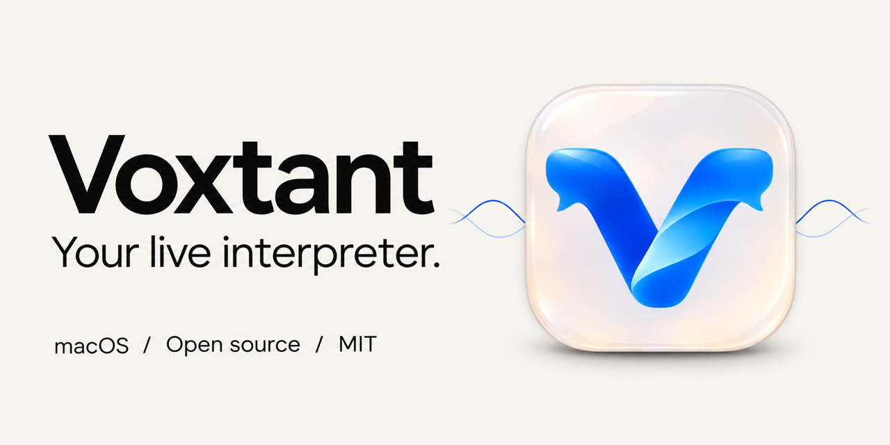

<p align="center"></p>

<p align="center"><strong>English</strong> · <a href="README.ru.md">Русский</a></p>

# Voxtant

**Keep listening. Read the translation.**

A small native macOS app that turns microphone speech into translated text in a floating glass panel. Open it from the menu bar, move it beside your work, and keep the conversation in view.

[macOS 14+](#get-started) · [MIT](LICENSE) · [Swift / SwiftUI](Package.swift) · **Experimental pet project**

<p align="center"></p>

## What it does

- A persistent, draggable, resizable panel above your other apps; menu-bar access and a separate settings window.
- Single-language translation or mixed speech with a translate/preserve rule for each source language.
- Scribe v2 or GPT Transcribe for recognition; GPT‑4.1 mini is the recommended translator. **One OpenRouter key.**
- Progressive translation previews. Stop cancels queued and active processing, then finishes the local audio write.
- Original audio, transcript, translation and session metadata saved on your Mac, grouped by date and recording.
- A quiet API-reported USD subtotal and approximate RUB conversion using a dated CBR rate. Missing prices remain unknown.

The initial use case is an English lecture with Mandarin examples: translate the explanation into Russian while keeping recognized Chinese characters. The app preserves the Chinese it recognized; it cannot guarantee that recognition itself is correct.

## Get started

**To run:** the deployment target is macOS 14+; the packaged build was checked on macOS 26 only. You need a microphone, internet access and your own OpenRouter key with credit. The current packaged build is **arm64 / Apple Silicon**. The interface is currently in Russian; the repository documentation is bilingual.

1. Get the application from [Releases](https://github.com/JustChimera/Voxtant/releases), or build it below. Move `Voxtant.app` into Applications.
2. Open the app and click the waveform in the macOS menu bar. Open Settings with the gear.
3. Save your OpenRouter key, choose a microphone, then start recording. Allow microphone access when macOS asks.
4. Use Stop to end capture and cancel unfinished requests. Hiding the panel keeps recording active.

Release packages are **ad-hoc signed, not Developer ID signed or notarized**. macOS may block a downloaded copy. If you trust its source, use Apple's [instructions for opening an unverified app](https://support.apple.com/102445); do not disable system-wide protection.

Native Liquid Glass requires macOS 26+. Earlier supported systems use an AppKit material. The panel's appearance depends on the desktop and accessibility settings.

## Language rules

Choose **Single** for one source → one target, or **Mixed** for several source languages. In mixed mode, untick translation for a language you want to keep in the original writing system. An optional recognition language hint is independent of the translation target.

English, Mandarin, Russian, German, French, Spanish, Italian, Portuguese, Japanese and Korean are configurable. Equal recognition/translation quality across these languages has not been established.

## Your recordings and data

```text
~/Desktop/Voxtant Recordings/
└── 2026-11-03/
    └── 14-30-00_A1B2C3D4/
        ├── recording.caf
        ├── transcript.txt
        ├── translation.txt
        ├── metadata.json
        ├── session.json
        └── chunks/*.wav
```

The API key is stored in **macOS Keychain**, never bundled with the app. During recognition, audio fragments go to OpenRouter and the selected ASR provider; text goes to the selected translation provider through OpenRouter. API usage is billed to your account. The app does not implement its own backend, accounts, telemetry or cloud library. A public CBR request supplies the optional currency reference.

The current source tree excludes personal audio, session exports and raw private evaluation outputs. Screenshots use authored demonstration text. Record with the participants' knowledge and according to the rules that apply to your situation.

Plain TXT/JSON exports can be consumed by your own tools or agents. See [local agent integration](docs/agent-integration.md). No server or MCP service is required.

## Build and develop

**Build tools:** Xcode 26+ with the macOS 26 SDK, Swift 6 toolchain, Python 3 and the macOS command-line tools. There are no external Swift package dependencies. Source builds use the host architecture; Intel builds and older OS versions have not been validated on this development machine.

```sh
git clone https://github.com/JustChimera/Voxtant.git
cd Voxtant
make dev       # Debug app, then open it
make verify    # Local Swift/Python tests, lint and debug build
make ui-smoke  # GUI checks with fixtures; no microphone, keys or paid APIs
make release   # Optimized app, ZIP, DMG and SHA256SUMS.txt in dist/releases/
make install   # Release build → ~/Applications/Voxtant.app; refuses overwrite
```

`make verify` never runs a paid model evaluation. Recordings, `.build`, `dist`, local configuration and credentials stay outside Git. Keep changes small; see [Contributing](CONTRIBUTING.md).

## How it works

```text
Microphone ──┬── Original CAF → local disk
             └── 1.2–2.8 s WAV → local speech gate → OpenRouter ASR
                                                      ↓
                                            Language / Chinese guards
                                                      ↓
                                              OpenRouter translation
                                                      ↓
                                         Floating panel + TXT / JSON
```

Audio capture and disk writing run independently of networking. The scheduler has two recognition and two translation slots. Chinese protection checks character order and repetitions where applicable; it does not invent missing characters. Translation previews stream, while final exports require a validated completed response.

## Honest limits

- This is **short-fragment speech processing**, not continuous streaming ASR. There is no latency SLA.
- Noise, accents, mixed languages and chunk boundaries can produce wrong or missing words. A fluent translation is not proof of a correct transcript.
- Long 60–90 minute sessions and every microphone/OS/language combination are not certified. An iPhone microphone must first be exposed by macOS Continuity.
- Stop retains completed text and original audio; unfinished translations are cancelled rather than drained.
- Human-verified real-lecture accuracy is not established. Synthetic script regression checks, machine-derived comparisons and Han retention are reported separately.
- Prices depend on the chosen route; interrupted or missing API billing makes the displayed amount incomplete. RUB is approximate.

## Engineering notes

[ASR selection](docs/asr-selection.md) · [Translator comparison](docs/translation-selection.md) · [Quality regression](docs/quality-regression.md) · [Validation tools](docs/validation.md) · [Recording library](docs/recording-library.md) · [Stop contract](docs/stop-behavior.md) · [Release notes](CHANGELOG.md)

The project explores native macOS interaction, microphone/device lifecycle, concurrent API work, cancellation, multilingual text protection and repeatable evaluation. It is open for inspection and contributions, without a production-readiness claim.

## License

[MIT](LICENSE). Build it, modify it and use it in your own projects. Model API access and its charges are separate from this license. [Brand assets and generation provenance](assets/brand/README.md).
