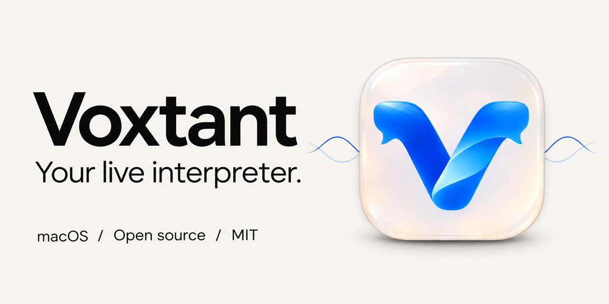

<p align="center"></p>

<p align="center"><a href="README.md">English</a> · <strong>Русский</strong></p>

# Voxtant

**Слушайте разговор. Читайте перевод.**

Небольшое нативное macOS-приложение, которое переводит речь из микрофона в плавающей стеклянной панели. Откройте его из строки меню, расположите рядом с рабочим окном и продолжайте слушать собеседника.

[macOS 14+](#начать-работу) · [MIT](LICENSE) · [Swift / SwiftUI](Package.swift) · **Экспериментальный pet-проект**

<p align="center"></p>

## Возможности

- Панель поверх других приложений: перетаскивание, изменение размера, доступ из строки меню и отдельные настройки.
- Обычный перевод одного языка или смешанная речь с правилом «переводить / сохранять» для каждого исходного языка.
- Scribe v2 или GPT Transcribe для распознавания; рекомендуемый переводчик — GPT‑4.1 mini. **Один ключ OpenRouter.**
- Постепенное появление перевода. Stop отменяет очередь и активную обработку, дожидаясь только локальной записи звука на диск.
- Исходный звук, транскрипция, перевод и метаданные на Mac, с группировкой по дате и записи.
- Небольшая строка стоимости: полученная от API сумма в USD и приблизительные рубли по датированному курсу ЦБ. Неизвестные суммы не заменяются нулями.

Первый сценарий — английская лекция с примерами на китайском: объяснение переводится на русский, распознанные иероглифы сохраняются. Приложение защищает уже распознанный китайский текст, но не гарантирует правильность самого распознавания.

## Начать работу

**Для запуска:** целевая минимальная версия — macOS 14+, готовая сборка проверена только на macOS 26. Нужны микрофон, интернет и свой ключ OpenRouter с балансом. Текущая готовая сборка — **arm64 / Apple Silicon**. Интерфейс приложения на русском; документация репозитория доступна на двух языках.

1. Возьмите приложение в [Releases](https://github.com/JustChimera/Voxtant/releases) или соберите из исходников. Переместите `Voxtant.app` в «Программы».
2. Запустите приложение и нажмите волну в строке меню macOS. Шестерёнка открывает настройки.
3. Сохраните ключ OpenRouter, выберите микрофон и начните запись. Разрешите доступ к микрофону, когда macOS его запросит.
4. Stop завершает захват и отменяет незаконченные запросы. Скрытие панели продолжает запись.

Пакеты имеют **локальную ad-hoc подпись, без Developer ID и нотариализации Apple**. macOS может заблокировать загруженную копию. Если доверяете источнику, следуйте [инструкции Apple](https://support.apple.com/102445); отключать защиту всей системы не нужно.

Нативный Liquid Glass используется на macOS 26+. Более ранние поддерживаемые версии получают материал AppKit. Вид стекла зависит от фона рабочего стола и настроек доступности.

## Языковые правила

В режиме «Обычный» выбирается один исходный и один целевой язык. В «Смешанном» можно добавить несколько исходных языков и снять галочку перевода у того, который нужно сохранить. Приоритетный язык распознавания — подсказка ASR, независимая от языка перевода.

Настраиваются английский, китайский, русский, немецкий, французский, испанский, итальянский, португальский, японский и корейский. Одинаковое качество на всех языках не подтверждено.

## Записи и данные

```text
~/Desktop/Voxtant Recordings/
└── 2026-11-03/
    └── 14-30-00_A1B2C3D4/
        ├── recording.caf
        ├── transcript.txt
        ├── translation.txt
        ├── metadata.json
        ├── session.json
        └── chunks/*.wav
```

API-ключ хранится в **macOS Keychain** и не входит в сборку. Аудиофрагменты поступают в OpenRouter и выбранному провайдеру распознавания; текст — провайдеру перевода через OpenRouter. Запросы оплачиваются с вашего аккаунта. У приложения нет собственного сервера, аккаунтов, телеметрии или облачной библиотеки. Публичный запрос к ЦБ нужен для необязательного справочного курса валют.

Текущее дерево исходников не содержит личного аудио, экспорта сессий и сырых результатов приватных прогонов. На скриншотах — специально написанный демонстрационный текст. Записывайте с ведома участников и с учётом применимых правил.

TXT/JSON можно читать своими инструментами и агентами: [интеграция с локальными файлами](docs/agent-integration.md). Сервер и MCP для этого не требуются.

## Сборка и разработка

**Инструменты:** Xcode 26+ с macOS 26 SDK, Swift 6 toolchain, Python 3 и системные инструменты macOS. Внешних Swift package dependencies нет. Сборка из исходников использует архитектуру текущего Mac; Intel и более ранние версии ОС на этой машине не проверены.

```sh
git clone https://github.com/JustChimera/Voxtant.git
cd Voxtant
make dev       # Debug-приложение и его запуск
make verify    # Локальные Swift/Python-тесты, lint и debug-сборка
make ui-smoke  # GUI-проверки на фикстурах, без микрофона, ключей и API
make release   # Оптимизированная сборка, ZIP, DMG и SHA256SUMS.txt в dist/releases/
make install   # Release → ~/Applications/Voxtant.app, без перезаписи существующего
```

`make verify` не запускает платные проверки моделей. Записи, `.build`, `dist`, локальные настройки и ключи не попадают в Git. Правила изменений — в [Contributing](CONTRIBUTING.md).

## Как это устроено

```text
Микрофон ──┬── Исходный CAF → локальный диск
           └── WAV 1,2–2,8 с → локальный фильтр речи → OpenRouter ASR
                                                         ↓
                                             Языковые правила / защита Han
                                                         ↓
                                                OpenRouter-переводчик
                                                         ↓
                                             Плавающая панель + TXT / JSON
```

Захват и запись звука независимы от сети. Планировщик использует два слота распознавания и два перевода. Защита китайского проверяет порядок и повторы символов там, где применима, но не придумывает пропущенные иероглифы. Черновик перевода появляется постепенно; окончательный экспорт требует завершённого проверенного ответа.

## Честные ограничения

- Это **перевод коротких аудиофрагментов с задержкой, зависящей от сети и API**, а не непрерывный потоковый ASR. Гарантированного времени ответа нет.
- Шум, акцент, смешение языков и границы фрагментов могут приводить к ошибкам и пропущенным словам. Красивый перевод не доказывает правильность оригинала.
- Сессии на 60–90 минут и все сочетания ОС, микрофонов и языков не сертифицированы. Микрофон iPhone должен сначала появиться в macOS через Continuity.
- Stop сохраняет готовый текст и исходный звук, а незавершённые переводы отменяет.
- Точность на реальных лекциях по независимой человеческой разметке не установлена. Синтетические проверки, сравнение с машинными ориентирами и сохранение Han считаются отдельно.
- Цена зависит от маршрута API; отменённые запросы и недостающие сведения делают сумму неполной. Рубли приблизительны.

## Инженерные материалы

[Выбор ASR](docs/asr-selection.md) · [Сравнение переводчиков](docs/translation-selection.md) · [Контроль регрессий](docs/quality-regression.md) · [Валидация](docs/validation.md) · [Хранение записей](docs/recording-library.md) · [Поведение Stop](docs/stop-behavior.md) · [Изменения](CHANGELOG.md)

Проект демонстрирует нативный macOS-интерфейс, жизненный цикл аудиоустройств, параллельные API-запросы, отмену, защиту мультиязычного текста и повторяемую оценку качества. Код открыт для изучения и доработок; готовность к production не заявляется.

## Лицензия

[MIT](LICENSE): используйте, изменяйте и развивайте проект. Доступ к моделям и оплата API регулируются отдельно. [Графические материалы и происхождение](assets/brand/README.md).
